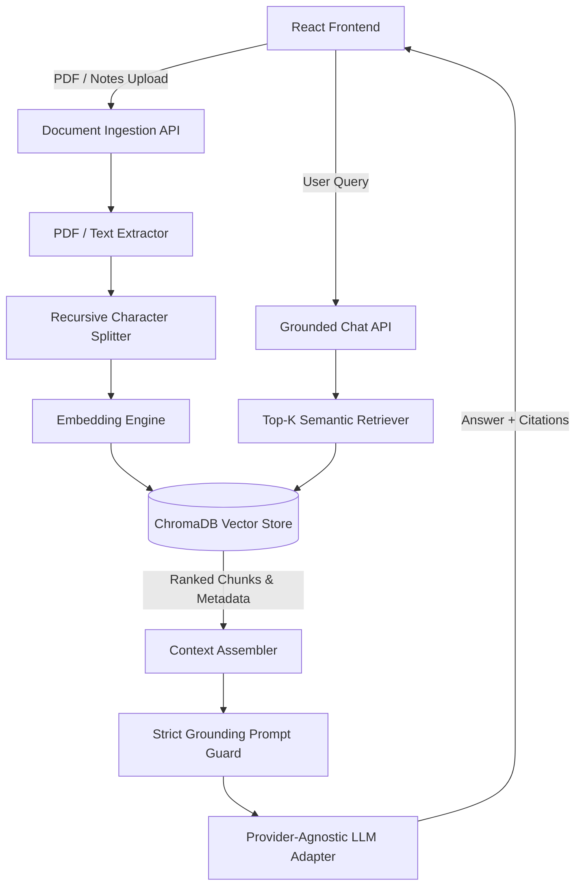
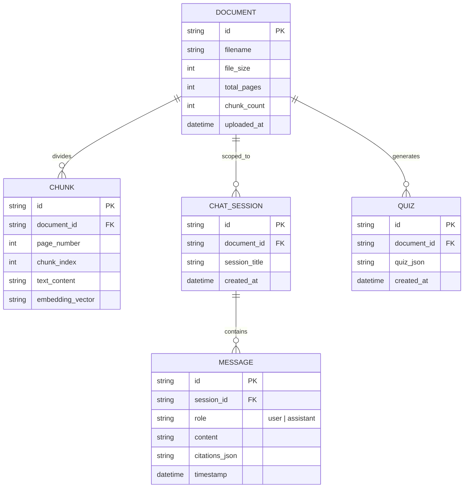

# Architecture Specification
## StudyBuddy RAG: System Design & Technical Contracts

### 1. High-Level Architecture
StudyBuddy RAG utilizes a high-throughput asynchronous RAG pipeline:
- **Frontend**: React 18 (Vite) + Tailwind CSS + Lucide Icons + React Markdown / SyntaxHighlighter.
- **Backend API**: FastAPI asynchronous backend with modular endpoints (`/documents`, `/chat`, `/quiz`, `/summary`).
- **Vector Database**: ChromaDB (embedded persistent vector store).
- **Universal LLM Adapter**: `services/llm_client.py` abstracting LLM API, OpenAI, Groq, or mock deterministic offline generator for automated test suites.



---

### 2. Document & Vector Schema



---

### 3. API Contract Specifications

| Method | Endpoint | Description | Request Body | Response (200 OK) | Error Codes |
|---|---|---|---|---|---|
| `POST` | `/api/v1/documents/upload` | Upload & ingest document | `multipart/form-data (file)` | `{doc_id, filename, pages, chunks_indexed}` | 413 File Too Large, 422 Invalid Format |
| `GET` | `/api/v1/documents` | List uploaded documents | None | `[{doc_id, filename, chunks, uploaded_at}]` | 200 OK |
| `POST` | `/api/v1/chat/query` | Grounded chat completion | `{document_id, session_id, message, top_k}` | `{response, citations: [{page, chunk_id, excerpt, score}]}` | 404 Doc Not Found, 503 LLM Error |
| `POST` | `/api/v1/quiz/generate` | Generate MCQ quiz from doc | `{document_id, num_questions, difficulty}` | `{questions: [{question, options, correct_idx, explanation, page_ref}]}` | 422 Invalid Params |
| `POST` | `/api/v1/summary/generate` | Synthesize executive summary | `{document_id, summary_type}` | `{executive_summary, key_terms: [...], takeaways: [...]}` | 404 Doc Not Found |

---

### 4. Strict Grounding System Prompt Contract
```text
You are StudyBuddy, an academic tutor dedicated to absolute factual accuracy.
Answer the user's inquiry strictly and solely using the provided context chunks below.
Rules:
1. Do not extrapolate, infer, or incorporate external world knowledge not stated in the context.
2. If the context does not explicitly contain the answer, reply EXACTLY with:
   "The uploaded material does not contain this information."
3. Every factual claim must be attributed to its Source Chunk ID and Page Number.
```
